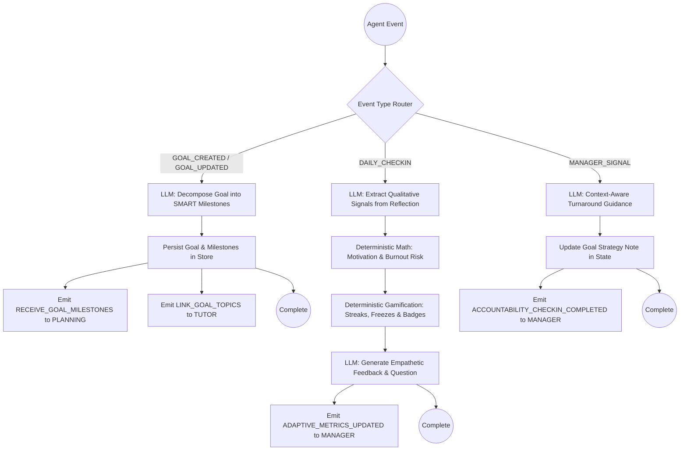

# Goal & Life Coach Agent (Member 4)
### Graduation Project: *Generative AI Personal Life & Study Coach*
**Egyptian DEPI Initiative (Digital Egypt Pioneers Initiative)**

---

## 1. Project & System Context

The overall graduation project is an autonomous multi-agent ecosystem designed to guide students and professionals through the learning and achievement lifecycle:

$$\text{Goals} \longrightarrow \text{Planning} \longrightarrow \text{Study \& Action} \longrightarrow \text{Assessment} \longrightarrow \text{Progress Tracking} \longrightarrow \text{AI Adaptation} \longrightarrow \text{Achieving Goals}$$

### The 5 Agent Roles

| Agent | Responsibility | Primary Mechanism |
| :--- | :--- | :--- |
| **1. Tutor / Generative Learning Agent** | Explanations, quizzes, flashcards, active recall drills | RAG + LLM |
| **2. Assessment Agent** | Topic mastery tracing, quiz grading, gap identification | Knowledge Tracing |
| **3. Personal Planning Agent** | Daily/weekly time-blocking, task generation, schedule optimization | Calendar Tools |
| **4. Goal & Life Coach Agent** *(THIS MODULE)* | **Goal decomposition, daily reflections, motivation & burnout tracking, gamification, accountability** | **LangGraph + Deterministic Metrics** |
| **5. Adaptive Manager Agent** | Oversees all agents, detects procrastination patterns, issues preemptive commands | System Orchestrator |

> **Our Agent's Core Thesis:**  
> *Planning answers **what and when**; the Goal & Life Coach answers **why, and how to keep going**.*

---

## 2. Agent Responsibilities & Workflows

This module functions as a **predictable, typed state machine** orchestrated by **LangGraph (`StateGraph`)**. It runs standalone today and plugs directly as a subgraph into the team's future orchestrator.



### Key Flows:
1. **`GOAL_CREATED` / `GOAL_UPDATED`**:
   - LLM decomposes raw natural language goals into 2 to 8 SMART milestones, each containing realistic micro-tasks (5–120 mins).
   - Generates 3–5 conceptual study tags routed to the **Tutor Agent** to link learning modules.
   - Emits structured milestones to the **Personal Planning Agent** for scheduling.
2. **`DAILY_CHECKIN`**:
   - LLM extracts qualitative signals only (mood, energy, friction, avoidance, burnout).
   - **Deterministic Python** calculates `motivation_index` and `burnout_risk`.
   - **Gamification engine** updates streaks, applies streak freezes, or executes the comeback rule.
   - LLM formulates concise, warm feedback (<120 words) with 1 reflective question.
3. **`MANAGER_SIGNAL`**:
   - Responds to supervisor triggers (e.g. `TRIGGER_ACCOUNTABILITY_CHECKIN` after 48h of procrastination).
   - Generates non-judgmental, psychologically grounded accountability interventions and updates the goal's strategy note.

---

## 3. Strict Architectural Rules

- **Zero Number Hallucination**: The LLM *never* computes mathematical scores, streaks, or probabilities. LLMs extract *qualitative cues* (`mood`, `energy`, `friction`, `avoidance_signals`, `burnout_signals`); pure deterministic Python functions compute `motivation_index`, `burnout_risk`, streak increments, and freeze deductions.
- **Freeze & Comeback Gamification**:
  - Consecutive day completion: `streak + 1`.
  - Missed day + freeze available: Consumes freeze, **streak continues unbroken** (`streak + 1`).
  - Missed day + 0 freezes: **Comeback Rule**: Halves the streak (`max(1, streak // 2)`), **never resets to zero**.
  - Freeze replenishment: 1 freeze awarded every 7 unbroken days (cap 2 stored).
  - Milestone Badges: Awarded at 3, 7, 14, and 30-day streaks.
- **Storage Decoupling**: All persistence lives behind a typed `Store` protocol (`load(user_id) -> CoachState`, `save(state) -> None`), with both `JsonStore` (file-backed) and `MemoryStore` (ephemeral/testing) implementations.
- **Free-Tier Friendly**: Optimized for Google Gemini `gemini-2.5-flash` via `langchain-google-genai` and Pydantic v2 structured outputs (`.with_structured_output`).

---

## 4. Directory Structure

```text
goal_coach_agent/
├── requirements.txt            # Minimal dependencies (langgraph, langchain, etc.)
├── .env.example                # API key and configuration template
├── README.md                   # Complete architectural guide
├── coach/
│   ├── __init__.py             # Public package exports
│   ├── schemas.py              # Agreed team Pydantic v2 models (verbatim)
│   ├── storage.py              # Store protocol, MemoryStore & JsonStore
│   ├── gamification.py         # Pure streak, freeze, comeback & badge math
│   ├── scoring.py              # Pure deterministic motivation & burnout scoring
│   ├── prompts.py              # Targeted prompts for structured extraction
│   ├── llm.py                  # init_chat_model wrapper + FakeCoachLLM fallback
│   ├── tools.py                # Standalone typed Python tools (create_goal, etc.)
│   ├── graph.py                # LangGraph StateGraph wiring the 3 workflows
│   └── agent.py                # GoalCoachAgent public contract: run(event)
├── tests/
│   ├── conftest.py             # Pytest path discovery
│   ├── test_gamification.py    # Unit tests for streaks, freezes & comebacks
│   ├── test_scoring.py         # Unit tests for motivation & burnout formulas
│   ├── test_storage.py         # Unit tests for JSON & in-memory persistence
│   └── test_agent_flows.py     # Integration tests with zero network calls
└── demo.py                     # Interactive runnable CLI demonstration
```

---

## 5. Setup & Installation

### Prerequisites
- Python 3.11 or higher (tested on Python 3.13)
- pip package manager

### 1. Clone & Install Dependencies
```bash
cd d:/DEPI/goal_coach_agent
pip install -r requirements.txt
```

### 2. Configure Environment Variables (Optional)
To use live Google Gemini models, obtain a free API key from [Google AI Studio](https://aistudio.google.com/):

```bash
cp .env.example .env
```

Edit `.env`:
```ini
GOOGLE_API_KEY=AIzaSy...your_real_gemini_key
COACH_MODEL=gemini-2.5-flash
COACH_STORAGE_DIR=./data
```

> **Note on Free Tier & Offline Mode**:  
> If no API key is provided, the agent **automatically and gracefully falls back to `FakeCoachLLM`**. You can run the entire test suite and CLI demo completely offline with zero configuration and zero API quota consumption!

---

## 6. Running Tests

The test suite runs with **100% mocked offline components**, ensuring instant verification without network requests:

```bash
# From within goal_coach_agent:
pytest tests -v

# Or from workspace root:
python -m pytest goal_coach_agent/tests -v
```

### Test Coverage Highlights:
- `test_gamification.py`: First completion, consecutive streaks, freeze consumption, comeback halving, freeze replenishment, 3/7/14/30-day badges.
- `test_scoring.py`: Motivation index bounds $[0, 1]$, burnout risk escalation, consecutive low-days compounding.
- `test_storage.py`: MemoryStore deepcopy isolation, JsonStore atomic writes and corrupt file recovery.
- `test_agent_flows.py`: LangGraph state machine execution, outbound event validation to PLANNING, TUTOR, and MANAGER.

---

## 7. Running the Live Demo

Run the interactive demonstration script:

```bash
python demo.py
```

The CLI demo simulates a multi-day student journey:
1. **Step 1**: Decomposes a major graduation project goal into 3 SMART milestones and emits events to PLANNING and TUTOR.
2. **Step 2**: Day 1 check-in: Logs positive study session, updates motivation to `0.67`, starts habit streak at `1`.
3. **Step 3**: Day 2 check-in: Logs consecutive day, advances streak to `2`.
4. **Step 4**: Missed Day (Oct 27 skipped, logged on Oct 28): **Streak Freeze fires!** Consumes 1 freeze, advances streak unbroken from `2 -> 3`, and awards the **3-Day Streak Badge**.
5. **Step 5**: High fatigue day: Reports exhaustion; deterministic scoring escalates burnout risk to `Medium (0.53)` and flags a strategy pivot.
6. **Step 6**: Adaptive Manager signal: Receives `TRIGGER_ACCOUNTABILITY_CHECKIN`, outputs a supportive micro-stepping recovery reply, and updates the goal's strategy note.
7. **Final Summary**: Prints the complete JSON-backed snapshot of the student state.

---

## 8. Multi-Agent Integration Contract

When the team wires all 5 agents together in the future LangGraph orchestrator, this agent is invoked using the standard signature:

```python
from coach import GoalCoachAgent, JsonStore, AgentEvent

store = JsonStore(base_dir="./shared_data")
coach_agent = GoalCoachAgent(store=store)

# Incoming event from orchestrator:
event = AgentEvent(
    event_type="DAILY_CHECKIN",
    user_id="student_123",
    payload={
        "date": "2026-10-30",
        "text": "Completed today's micro-task on backpropagation.",
        "completed_habits": ["Deep Work 60m"],
    }
)

result = coach_agent.run(event)

# Read outbound events to route to other agents:
for outbound in result.outbound_events:
    if outbound.target == "PLANNING":
        pass  # Route to Personal Planning Agent
    elif outbound.target == "MANAGER":
        pass  # Route to Adaptive Manager Agent
    elif outbound.target == "TUTOR":
        pass  # Route to Tutor / Generative Learning Agent
```

