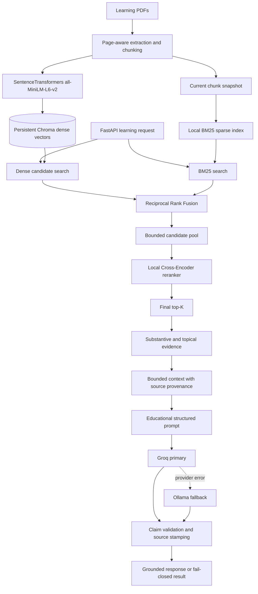

# Generative Learning Model

FastAPI service for learning explanations, summaries, assessments, flashcards, practice exams, and answer feedback grounded in uploaded course PDFs.

## Architecture



All learning endpoints share this production pipeline through `LearningGenerator._context()`. Grounding responses and concise logs identify `hybrid_cross_encoder`; logs include dense, sparse, fusion, Cross-Encoder, and total latency.

### Why hybrid search and reranking

Dense search finds semantically similar passages when wording differs. BM25 finds exact terms, names, and rare vocabulary in the same persisted Chroma chunks. Reciprocal Rank Fusion combines ranks without comparing unlike score scales. A Cross-Encoder scores only that bounded candidate pool as `(query, passage)` pairs, improving passage relevance at a higher but measurable compute cost.

Defaults search 30 dense and 30 sparse candidates, fuse with RRF constant 60, rerank at most 30 passages, and return 5. Each learning request may override final evidence count with `top_k` from 1–20; candidate pools expand when needed. The final top-K alone proceeds to evidence filtering and context construction. BM25 is a local in-memory snapshot rebuilt from Chroma at startup and refreshed after PDF synchronization. This avoids a second persistent index that could drift from Chroma at this project's current scale. Synchronization removes chunks for PDFs deleted from the synchronized directory.

Evidence filtering rejects empty or non-substantive text and enforces topical overlap; “why” questions additionally require causal or functional evidence. Claim validation remains a separate, stricter check for unsupported statements and numbers. Retrieval scores do not prove generated claims. In `learning_materials_only`, insufficient evidence returns without generation. `learning_materials_then_general_knowledge` allows general fallback only when filtered evidence is insufficient; adequate retrieved evidence remains strictly checked.

The corpus is shared across documents. Although retrieval accepts metadata filters internally, the API has no authenticated user/document ownership mapping and ingestion does not assign user IDs. This supports multiple local documents, not secure multi-tenant isolation; wire authenticated ownership to filters before exposing user-specific materials in a multi-user deployment.

The Cross-Encoder loads lazily once per process and is reused. `auto` selects CUDA when available and otherwise falls back to CPU. Model loading and CPU inference add latency; the per-stage logs make that cost visible. Its raw logits are calibrated with `CROSS_ENCODER_SCORE_OFFSET` before sigmoid normalization because they do not use the cosine score scale of the previous context gate.

The default LLM order is Groq then Ollama. If both fail the API returns a provider error; it never silently uses deterministic output. Deterministic generation is opt-in for tests/development with `LLM_PROVIDER=deterministic`. Generated responses include `generation.provider`, `generation.model`, and `generation.fallback_used`.

## Install and run

Use Python 3.11 or newer:

```powershell
Copy-Item .env.example .env
# Set GROQ_API_KEY in the local .env file (never commit it).
.\.venv\Scripts\python.exe -m pip install -e ".[dev]"
.\.venv\Scripts\python.exe -m uvicorn app.main:app --reload
```

SentenceTransformers loads `sentence-transformers/all-MiniLM-L6-v2` once per process. Its model files are downloaded/cached on first use. The model determines its own vector dimension. Ingestion and dense retrieval share this encoder. The default reranker is `cross-encoder/ms-marco-MiniLM-L-6-v2`.

## Configuration

Set local values in `.env`:

```text
LLM_PROVIDER=groq
LLM_FALLBACK_PROVIDER=ollama
GROQ_API_KEY=your-local-secret
GROQ_MODEL=openai/gpt-oss-120b
OLLAMA_BASE_URL=http://localhost:11434
OLLAMA_MODEL=qwen2.5:7b-instruct
EMBEDDING_PROVIDER=sentence_transformers
EMBEDDING_MODEL=sentence-transformers/all-MiniLM-L6-v2
CHROMA_PATH=./data/chroma
CHROMA_COLLECTION=learning_materials_minilm
SAMPLE_DATA_DIR=sample_data
AUTO_INGEST_PDFS=true
RETRIEVAL_STRATEGY=hybrid_cross_encoder
DENSE_CANDIDATE_K=30
SPARSE_CANDIDATE_K=30
RRF_K=60
RERANK_CANDIDATE_K=30
FINAL_TOP_K=5
CROSS_ENCODER_MODEL=cross-encoder/ms-marco-MiniLM-L-6-v2
CROSS_ENCODER_DEVICE=auto
CROSS_ENCODER_BATCH_SIZE=16
CROSS_ENCODER_SCORE_OFFSET=5.0
MIN_RELEVANCE_SCORE=0.35
```

Never commit `.env` or put a real key in `.env.example`, source code, logs, or documentation. The example file contains no credentials. Install and start Ollama separately, then pull the configured model (for example `ollama pull qwen2.5:7b-instruct`). Groq is the primary provider; an Ollama connection/API/model failure triggers fallback. Groq requests use the documented chat-completions endpoint, a Bearer authorization header, an explicit service User-Agent, and JSON-Schema response mode (the configured GPT-OSS model supports it). Provider/API diagnostics redact credentials and do not log prompts. Run `scripts/diagnose_groq.py` for a minimal authenticated check that reports provider, endpoint, model, success/failure, and safe error details only.

## Ingest and migrate PDFs

At application startup, PDFs under `SAMPLE_DATA_DIR` (recursive; default `sample_data/`) are synchronized into the existing `learning_materials_minilm` collection. SHA-256 file fingerprints skip unchanged PDFs; changed PDFs are upserted and obsolete chunks for that exact resolved source path are deleted only after replacement chunks are ready. Chunk metadata includes source path, filename, and file hash. Legacy chunks without a fingerprint are refreshed once when their stable source-path identity is available; ambiguous filename-only chunks are left untouched. `AUTO_INGEST_PDFS=false` disables startup synchronization. `scripts/ingest_sample.py` runs the same synchronizer manually. The application preserves the configured Chroma path, collection, embedding identity, and existing collection contents for unrelated sources.

`GET /health` checks liveness; `GET /ready` reports Chroma collection and chunk count. `POST /learning/explain` is available in `/docs`. Responses list retrieved document/page/chunk, relevance score, and retrieval method; in `learning_materials_only` mode, insufficient evidence returns `insufficient_context` without calling an LLM.

## Verify and test

```powershell
.\.venv\Scripts\python.exe -m pytest
.\.venv\Scripts\python.exe scripts\evaluate.py
.\.venv\Scripts\python.exe scripts\benchmark_hybrid_cross_encoder.py
.\.venv\Scripts\python.exe scripts\smoke_test_llm.py
.\.venv\Scripts\python.exe scripts\diagnose_groq.py
```

The smoke test makes a real request to the configured primary/fallback provider and reports the actual provider metadata. Tests cover primary/fallback behavior, fail-closed handling, metadata, embedding batches/cache, page-aware ingestion/deletion, BM25, RRF, Cross-Encoder behavior, and all API endpoints. The new hybrid benchmark labels pages across the included PDFs and reports Recall/Hit Rate at 1/3/5/10, MRR, average/p95 latency, and each retrieval stage. The existing benchmark remains unchanged. External provider smoke tests require valid local configuration and reachable services.

## API and integration ownership

Endpoints: `GET /health`, `GET /ready`, and `POST /learning/{explain,summarize,mcq,flashcards,exam,evaluate-answer}`. Learner profiles arrive in request bodies; user records, authentication, study sessions, and schedules remain owned by the larger application.

See [docs/PARAMETER_BEHAVIOR_AUDIT.md](docs/PARAMETER_BEHAVIOR_AUDIT.md) for the full request/configuration parameter audit, bounds, sensitivity tests, and ready-to-use Swagger comparison payloads.
