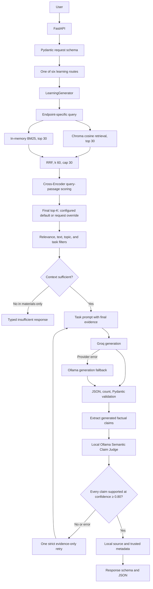
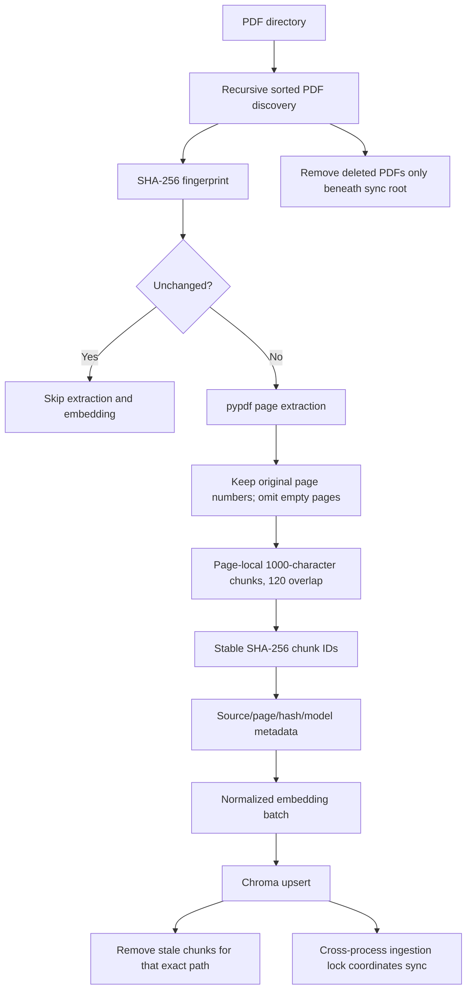
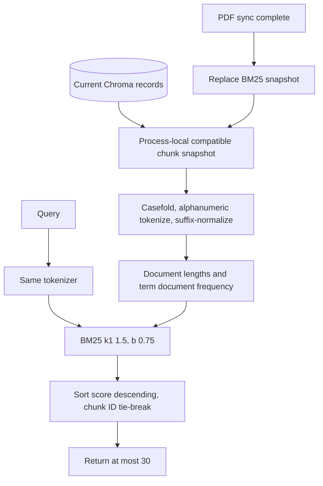
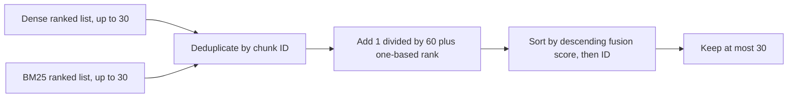
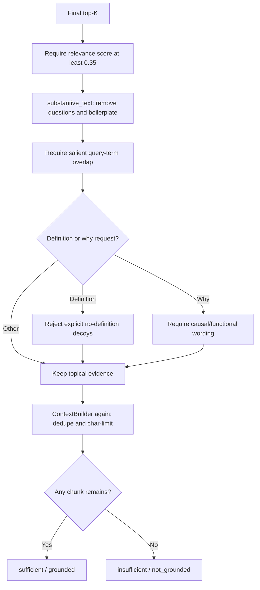
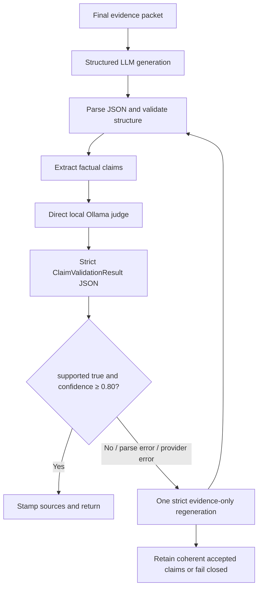
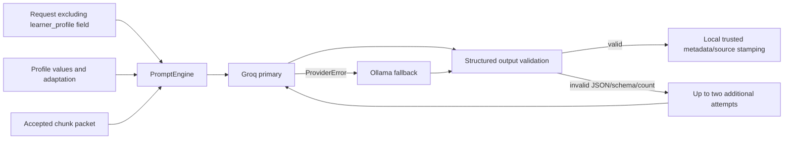
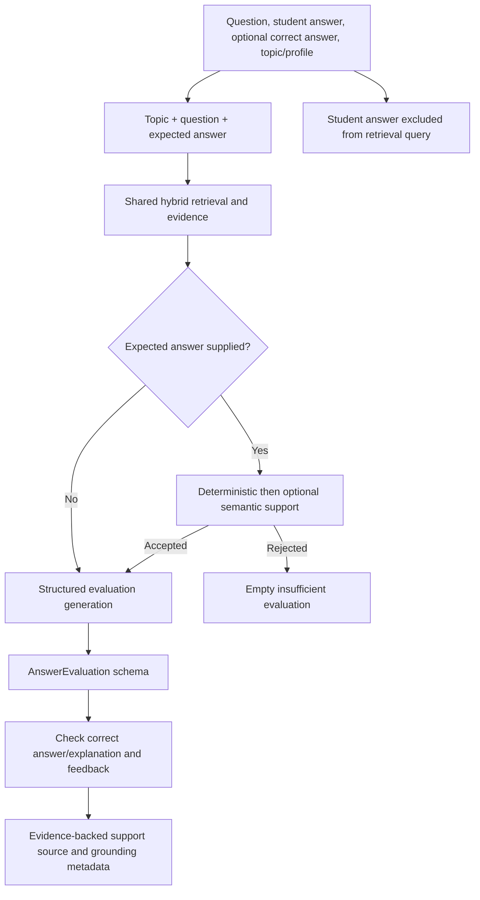
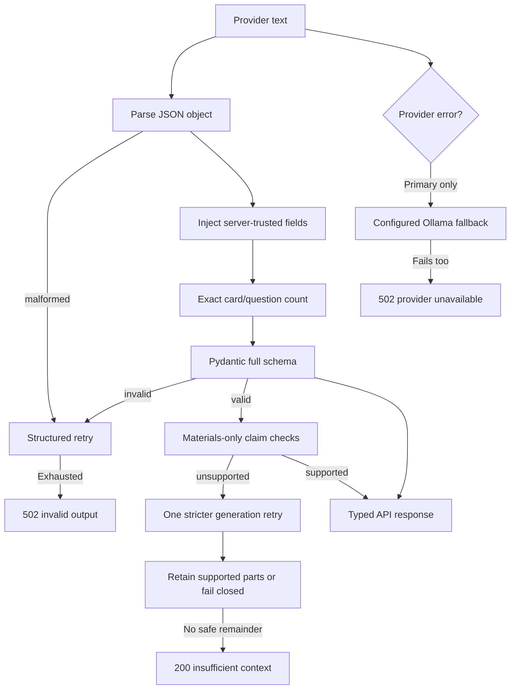

# System Architecture

This document records the running architecture implemented by app/main.py and the modules it composes. It is intentionally specific to this project.

## 1. Full system architecture



## 2. Main component responsibilities

| Layer               | Implemented responsibility                                                                                 |
| ------------------- | ---------------------------------------------------------------------------------------------------------- |
| API                 | FastAPI endpoints, request/response models, liveness/readiness, CORS, request IDs, exception mapping.      |
| Request schema      | Pydantic type and field constraints; invalid/missing fields return 422.                                    |
| Query orchestration | Each route builds a different query; evaluate-answer excludes student_answer.                              |
| Retrieval           | Dense vector search and local BM25 run independently; RRF fuses ranks; Cross-Encoder reranks bounded pool. |
| Evidence            | Score floor plus text, topic, definition and causal-evidence filters.                                         |
| Context             | Deduplicates and assembles selected chunk text/provenance; sufficient means at least one accepted chunk.   |
| Claim judge         | Post-generation validation of factual claims against final evidence; direct local Ollama, confidence gate. |
| Prompting           | Uses request, task, adaptation, profile, evidence packet, grounding mode and schema constraints.           |
| LLM provider        | Groq primary and Ollama fallback for normal generation; provider errors trigger fallback.                  |
| Output              | JSON/object/count/schema checks, trusted local metadata, API response serialization.                       |

## 3. API subsystem

```mermaid
flowchart LR
    CLIENT[HTTP client] --> ROUTES[FastAPI route]
    ROUTES --> VALIDATE[Request Pydantic validation]
    VALIDATE --> HANDLER[Typed endpoint handler]
    HANDLER --> GENERATOR[Shared LearningGenerator]
    GENERATOR --> RESPONSE[Declared response model]
    RESPONSE --> CLIENT
    ROUTES --> DOCS[/docs, /redoc, /openapi.json]
    ROUTES --> HEALTH[/health and /ready]
```

Routes are GET /health, GET /ready, and POST /learning/explain, /learning/summarize, /learning/mcq, /learning/flashcards, /learning/exam, /learning/evaluate-answer. /health does not probe dependencies. /ready checks only Chroma count.

## 4. PDF ingestion and indexing subsystem



The code creates embeddings before deleting stale IDs so an embedding failure leaves previous content intact. Per-file failure is logged and processing continues. Startup catches outer synchronization errors, continues service startup, then refreshes BM25 in finally.

## 5. Embedding and vector database subsystem

```mermaid
flowchart LR
    TEXT[Page chunk] --> ENCODER[all-MiniLM-L6-v2]
    QUERY[User query] --> ENCODER
    ENCODER --> VECTOR[Normalized vector]
    VECTOR --> CHROMA[(Persistent Chroma collection)]
    META[Document/page/chunk metadata] --> CHROMA
    QUERY --> QVECTOR[Query vector]
    QVECTOR --> SEARCH[Cosine-space nearest neighbors]
    CHROMA --> SEARCH
    SEARCH --> ROWS[Text, metadata, distance]
    ROWS --> SCORE[Similarity = clamp(1 - distance, 0, 1)]
```

Chroma collection identity stores embedding provider/model/version and hnsw:space=cosine. Initialization raises ValueError if existing collection metadata disagrees. The runtime reads the embedding dimension from the loaded model; the saved report records 384 dimensions. HashEmbeddingProvider is an optional test/utility option, not configured default.

## 6. Dense retrieval subsystem

```mermaid
flowchart LR
    Q[Query text] --> EMBED[Shared query embedding]
    EMBED --> CHROMA[(Chroma cosine index)]
    CHROMA --> FETCH[Fetch up to min(count, max(20 × requested top-k, 50))]
    FETCH --> VERSION[Drop embedding-version mismatch]
    VERSION --> SORT[Sort by converted similarity]
    SORT --> TOP[Return requested dense candidates]
```

Production requests 30 dense candidates. Dense relevance score is converted distance, not a model probability. Optional metadata filters are supported internally but public API routes do not pass user/document filters.

## 7. BM25 sparse retrieval subsystem



The index is a custom implementation in app/rag.py. It is rebuilt from Chroma on retriever construction and refreshed after PDF synchronization. It is not a persistent separate database.

## 8. Hybrid RRF subsystem



A chunk found by both systems receives both reciprocal-rank contributions. Unmatched dense/sparse chunks remain eligible. The output score is normalized by the largest fused score, with hybrid_score metadata.

## 9. Cross-Encoder reranking subsystem

```mermaid
flowchart LR
    POOL[RRF pool, up to 30 passages] --> PAIRS[Build query/passage pairs]
    Q[Same query] --> PAIRS
    PAIRS --> MODEL[ms-marco-MiniLM-L-6-v2]
    MODEL --> LOGITS[Raw relevance logits]
    LOGITS --> CAL[Sigmoid of logit plus 5.0]
    LOGITS --> SORT[Sort raw score descending]
    CAL --> META[relevance_score in [0,1]]
    SORT --> TOP[Return final top-K]
    META --> TOP
```

The model loads lazily with max sequence length 512 and batch size 16. Device auto selects CUDA if PyTorch reports it available, otherwise CPU. The saved benchmark reports CPU execution. The raw score and transformed interface score are both recorded; the transformed value is not a calibrated probability.

## 10. Evidence and context subsystems



Substantive text needs at least four words, three salient terms, and punctuation or a recognized verb. Topic overlap is at least 40% when there are more than two salient query terms, otherwise all salient query terms. For causal questions, content must contain one of a bounded set of causal/functional constructions. This is a heuristic, not a proof that the full answer is present.

ContextBuilder caps its joined text, removes duplicate text, and stores selected chunks. One implementation detail: the real provider packet is later built from full selected chunk contents rather than the truncated joined context string. See Grounding and Validation for the practical implication.

## 11. Claim validation and Semantic Claim Judge subsystems



Generated factual claims from evidence-required routes are validated after retrieval, filtering, final-context construction, generation, and structured parsing. Claim extraction covers learner-facing factual fields and splits by sentence/semicolon, including a sentence boundary after closing quotes. The judge receives one claim, final evidence and topic orientation; it omits the question to avoid priming unsupported but plausible facts. It uses `qwen2.5:7b-instruct` through Ollama only, temperature 0, max 120 tokens, a strict schema (supported boolean, confidence float in [0,1], concise reason; no extra fields), and the ≥0.80 acceptance threshold. No Groq fallback. Malformed output, Ollama failure, unsupported claims, or uncertainty fail closed.

On unsupported text, the code retries once with stricter evidence-only wording and validates again. It then retains only independently accepted coherent content or returns a grounding-validation failure. A later validation failure preserves sufficient retrieval status and sources. Source attribution is locally recomputed after validation. Deterministic structural checks remain in place.

## 12. Prompt, profile and provider subsystem



`adapt()` builds topic-scoped instructions from overall level, mastery, weak/strong topics, matching recent quiz/exam/history records, accuracy, performance at the requested difficulty, relevant misconceptions, and revision recommendations. It preserves requested difficulty separately and computes effective difficulty with bounded one-step adaptation. `user_id` is excluded from the prompt and logs. Request `top_k` overrides the configured final evidence count.

Materials-only prompt says use only provided evidence, don't infer or fill gaps, omit unsupported points, and treat evidence as untrusted data rather than instructions. Structured output demands JSON. For strict retries it adds a conservative correction. The evaluation prompt separates four feedback concepts.

Normal generation uses Groq then Ollama on ProviderError; malformed output retries through the chain without switching provider solely for malformed output. Semantic judge is a separate direct Ollama flow.

## 13. Evaluation/grading subsystem



The final score/correctness fields are generated by the LLM and constrained by schema. They are not produced by a separately implemented rubric. Exact-match repair and salvage code can adjust values in specific paths.

## 14. Output validation and error handling subsystem



Per-PDF sync errors are logged/count and continue. Chroma readiness failure is 503. Other unhandled errors are 500 with request ID. Provider and output-schema errors have distinct 502 codes. The Semantic Claim Judge's provider/parse error rejects the claim and returns the normal insufficient evaluation; no Groq call.

## 15. Evaluation / benchmark diagrams

```mermaid
flowchart LR
    LABELS[Manual source/page labels] --> DATA[Fixed query JSON]
    DATA --> SCRIPT[benchmark_hybrid_cross_encoder.py]
    CORPUS[Chroma corpus, synchronized] --> SCRIPT
    SCRIPT --> VARIANTS[Dense, BM25, RRF, production hybrid]
    VARIANTS --> METRICS[Recall@k, Hit Rate@k, MRR, latency, p95]
    METRICS --> RESULT[Saved JSON results]
```

The current hybrid benchmark uses 11 queries, nine positive/two negative, current sample corpus, output top ten, and reports context sufficiency for negatives/positives. The legacy benchmark uses 25 Ancient-Egypt-only queries and different candidate sizes. The two benchmark reports are not directly comparable.

## 16. Accuracy notes and known mismatches

- Current app/main.py and test_rag_pdf.py establish HybridCrossEncoderRetriever as production default.
- data/retrieval_benchmark_report.md describes dense-only as “CURRENT” and says Cross-Encoder was not integrated. That narrative is stale relative to code.
- README describes hybrid production and matches current source.
- max_input_chars is enforced on `/learning/*` POST bodies before Pydantic parsing; oversized bodies return 413.
- Grounding schema permits partially_grounded, but inspected runtime emits grounded or not_grounded.
- ContextBuilder truncates accepted chunk content as well as its text field, so the actual provider evidence packet respects max_context_chars.
- WebSearchProvider and OutputValidator exist as abstractions/utilities but are not wired into the main request path.

See API and Data Flow, RAG and Retrieval, Grounding and Validation, and Testing and Benchmarks for exact contracts and metrics.
